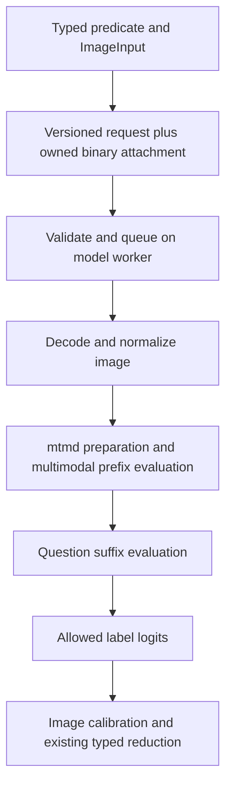

# Image answers research and design

Status: proposal, 2026-10-19. This is a repository design for adding image inputs to LARS; no image inference has been implemented or benchmarked as part of this research.

Implementation follow-up: the experimental image path is now available; see [image answers](images.md) for the implemented API and limits. This document preserves the initial research proposal, including evaluation and calibration work still to do.

## Recommendation

Extend LARS's existing predicates to accept an explicit image input, with optional text or JSON context. Start with one still image and `noul` / `choice`, running locally through the pinned llama.cpp multimodal library. Preserve direct option-logit scoring, typed return values, and `decide()` rather than introducing generated JSON as the inference contract.

Make direct scoring an experimental hypothesis first. A vision model can understand an image yet perform poorly when forced to answer immediately after `Answer:`. Compare that path against the same model generating an answer on a fixed evaluation set before investing in training or public bindings.

First compare Qwen3.5-2B without the LARS adapter, the existing LARS-tuned language weights paired with a compatible vision component, and Qwen3-VL-2B-Instruct. Use SmolVLM2-2.2B as an optional architectural comparison. Select the shipping pack on measured accuracy, calibration, memory, and latency; model-card results do not establish LARS performance.

## What the repository already provides

The inspected llama.cpp checkout is `fb4b2737a808a3fb7c2117a498f43815dc9be53e`. No submodule update is needed merely to begin a spike.

| Area | Current behavior | Design consequence |
| --- | --- | --- |
| `lars-core/src/schema.rs` | `state` is JSON content; unknown top-level fields are ignored | Do not put image bytes inside ordinary state or append an optional image field to the legacy request |
| `lars-core/src/backend.rs` | Backends receive string prefixes, suffixes, and option labels | Add an explicit multimodal scoring contract |
| `lars-core/src/render.rs` | V1 puts state before questions; V2 puts each question before state | Introduce a versioned image-first layout; V2 cannot share a single image-conditioned prefix across questions as written |
| `lars-core/src/engine.rs` | Rows group by textual prefix; some rows request hidden states separately | Group by complete input identity and keep media alive across all row groups |
| `lars-llama/src/lib.rs` | Prefix lengths and suffix positions derive from text token counts; recurrent models use snapshots | Separate embedding token counts from logical positions; verify snapshot and suffix behavior for each model |
| `lars-llama-sys/build.rs` | Builds llama.cpp with tools/common disabled; no mtmd integration | Build and link the standalone mtmd target and expose a narrow wrapper |
| `lars-runtime/src/pack.rs` | Format 1 packs; identity is name, version, model hash; downloads enumerate known artifacts | Add projector download/verification and a stronger identity in a new pack format |
| `lars-ffi/src/lib.rs`, `lars-node`, language bindings | Requests cross native boundaries as JSON | Add a versioned image request path and binary attachments without breaking text calls |
| `ts/src/index.ts` | Predicates default to string inputs; `ask()` returns decision objects and uses the first predicate's state selector | Add explicit input generics and a consistent shared-input rule |

Paths in this table are relative to `crates/` except `ts/src/index.ts`. These are findings from the local checkout, not promises about future runtime behavior.

## Inference approaches

| Approach | Fit for LARS | Decision |
| --- | --- | --- |
| Vision-language model, direct option logits | Can reuse the typed reduction and calibration machinery; immediate-answer quality needs measurement | Primary experiment |
| Vision-language model, generated answer | Supplies a useful accuracy baseline; adds decoding cost and an output interpretation step | Evaluation baseline |
| Contrastive image/text model | Useful for matching images to label descriptions; arbitrary question answering requires a different task formulation | Optional baseline for simple classification |
| OCR followed by text LARS | Useful where text is sufficient; discards visual evidence outside the transcription | Optional baseline for document tasks |

CLIP exposes image/text similarity scoring. Treat that as a distinct baseline, not evidence that a similarity score answers arbitrary visual predicates. [CLIP implementation](https://github.com/openai/CLIP).

llama.cpp provides multimodal input through libmtmd, with a language GGUF and corresponding projector GGUF. This preserves LARS's in-process deployment model. [llama.cpp multimodal documentation](https://github.com/ggml-org/llama.cpp/blob/master/docs/multimodal.md).

### Model shortlist

| Candidate | Reason to evaluate | Main question |
| --- | --- | --- |
| Qwen3.5-2B, original post-trained weights | Its model card exposes image/text input; same base family as the current 2B development pack | Does immediate label scoring work without reasoning generation? |
| LARS-tuned Qwen3.5-2B plus matching vision component | Tests reuse of the existing decision tuning | Has text tuning preserved visual grounding? |
| Qwen3-VL-2B-Instruct | Dedicated image/text checkpoint at a comparable declared scale | Does it give a better accuracy/latency tradeoff through this runtime? |
| SmolVLM2-2.2B-Instruct | Different multimodal architecture supported by mtmd | Is it a useful alternative if the Qwen integration is costly? |

The upstream cards list Apache 2.0 for Qwen3.5-2B, Qwen3-VL-2B-Instruct, and SmolVLM2-2.2B. Record exact revisions and artifact provenance when creating packs. Their published evaluations use their own protocols, not LARS's direct scoring protocol. [Qwen3.5 card](https://huggingface.co/Qwen/Qwen3.5-2B), [Qwen3-VL card](https://huggingface.co/Qwen/Qwen3-VL-2B-Instruct), [SmolVLM2 card](https://huggingface.co/HuggingFaceTB/SmolVLM2-2.2B-Instruct).

Do not assume the current text pack contains a usable vision tower, that matching architecture names establish weight compatibility, or that upstream vision benchmark scores survive the LARS adapter. Verify conversion, model/projector compatibility, template, and non-thinking mode against the exact artifacts.

## Proposed public API

These examples describe proposed APIs, not current exports. Pack names are placeholders.

```ts
const lars = await Lars.open({ pack: "lars-vision-2b-dev" });
const photo = await Lars.imageFile("./delivery.jpg");
// Also proposed: Lars.imageBytes(bytes). Copies the supplied encoded bytes.

const damaged = lars.noul<ImageInput>(
  "damaged", "The package has visible damage",
);
const location = lars.choice(
  "location", "Where was the package left?",
  {
    doorstep: "At a door",
    mailbox: "Inside a mailbox",
    lobby: "In a building lobby",
    other: "Somewhere else or not identifiable",
  },
  { state: (input: ImageInput) => input },
);

if (await damaged(photo)) flagDelivery();

const answers = await lars.ask(photo, { damaged, location });
// ask() keeps its existing decision-object shape:
// answers.damaged.value, .p, .confidence, .accepted
// answers.location.value, .probabilities, .confidence, .accepted

const contextualPhoto = photo.withContext({ expectedLocation: "front door" });
const decision = await damaged.decide(contextualPhoto);
```

Export an opaque, immutable `ImageInput` that owns encoded bytes and optional `Content` context. It should not depend on an open engine, hold GPU resources, or serialize to its raw bytes through ordinary `JSON.stringify`. A file helper reads and snapshots bytes immediately; later changes to the file do not alter an existing input. Decode and model-specific preparation happen on the model worker. A type named `ImageInput` also avoids collision with browser `Image`.

Preserve string and JSON inputs exactly. Widen the state selector's return type to `Content | ImageInput`; keep image detection outside ordinary JSON traversal. An application record can explicitly select its image and desired context. Reject opaque images accidentally nested in ordinary state rather than silently serializing their internals.

Use equivalent wrappers in Rust and C#: `ImageInput::from_bytes` / `from_file`, and `ImageInput.FromBytes` / `FromFileAsync`. Predicates and enums retain their existing result types. Settle exact language signatures when wiring the bindings; the first inference experiment should be Rust-only.

For `ask()`, require every predicate to resolve to the same image and context. Compare resolved input identities, or require a single explicit shared selector. Reject mismatches; the current first-selector behavior must not silently ask about a different photo. Validation must not run selectors twice with potentially different results.

### First release scope and behavior

- One JPEG or PNG still image, optionally accompanied by text or JSON context.
- `noul` and `choice`, including multiple questions in one request and choice permutations.
- No implicit URL fetching. Applications can fetch bytes explicitly before calling LARS.
- No `explain` on image inputs in the first release: sentence deletion is not visual evidence. Reject that combination explicitly.
- Defer public image `score`, `multi`, hidden-state heads, multi-image comparison, video, bounding boxes, and transcription until evaluated.
- Keep boolean threshold and acceptance behavior consistent with text. A rejected or abstained answer is not a visual negative; applications needing that distinction use `decide()`.
- A valid but unclear picture still produces an allowed answer. Support explicit unclear/other options and calibrated rejection; do not equate low confidence with reliable detection of unreadability.

Proposed resource defaults for the experiment: 20 MiB encoded input, 40 million decoded pixels, one frame, and a bounded model-specific visual token budget. These are starting limits, not measured optimal settings. Validate format, dimensions, integer arithmetic, and allocation budgets before full decoding. Reject corrupt, unsupported, animated, or over-budget input deterministically. Normalize orientation and alpha against a recorded background policy consistently across bindings; use a decoder capable of enforcing these limits before handing pixels to mtmd.

## Native architecture



### Request and attachment contract

Do not reinterpret arbitrary `state` objects as images: existing users can already pass any JSON object. Also do not add only a top-level `images` field to the current JSON request: the current parser ignores unknown top-level fields, so an older native library could silently answer from text alone.

Add a separate, capability-checked native operation for multimodal requests. Its JSON envelope includes an explicit format version, ordinary context, questions, options, and one attachment descriptor. The descriptor indexes an owned byte buffer supplied alongside JSON; it is not a filesystem path or a remote URL. Capability negotiation checks both native support and loaded-pack support before dispatch. Legacy runtimes must produce an explicit unsupported-operation error.

For N-API pass an encoded buffer separately. For C expose a new function accepting a byte pointer and length, copying the buffer before returning from async submission. Use the same owned attachment representation internally in Rust. Keep it alive through queueing, scoring, cancellation, and all callbacks. Limit queued image bytes as well as bytes per image to prevent concurrent requests from exhausting memory. Preserve the existing queued cancellation contract; do not promise interruption inside GPU work.

Calibration examples need the same attachment path. Replace the assumption that every example can be represented solely as a JSONL state; do not serialize megabytes of base64 repeatedly into the existing calibration strings. Add a multimodal calibration submission path that uses a bounded collection or stream of owned attachments and label descriptors. The experiment may collect raw logits directly before exposing this API.

### Build and backend contract

The pinned CMake already supports `LLAMA_BUILD_MTMD=ON` independently of tools/common. Enable it with video disabled for the experiment. Check install artifacts and static link dependencies on each platform: the current linker ranks `llama` before unknown libraries, so adding `mtmd` without updating dependency order may fail with static archives. Keep upstream source pinned.

Wrap mtmd lifecycle and evaluation through a small C/C++ shim or carefully reviewed bindings. Keep model, projector, prepared chunks, and context ownership on the existing model worker; mtmd's evaluation helpers are documented in the local headers as not thread-safe.

Add a separate backend method accepting a prepared multimodal prefix plus question suffixes. Default implementations reject unsupported inputs. Do not force binary content through the existing string `label_logits` method, and do not change the text scoring path to accommodate the spike.

Use a new `vision-v1` renderer: pack-specific system/template material, image and optional fenced context in the shared user prefix, then the question/options and fixed assistant answer prefix in each suffix. Obtain image markers and model-specific image tokens through mtmd; do not interpolate user-controlled marker strings as image boundaries. Include a deliberate way to render text context containing reserved markers literally or reject it.

Verify that each allowed answer label, including its leading space, remains exactly one token at the real answer boundary. Record label token IDs and template fixtures. Control non-thinking mode explicitly where applicable; a template that expects a reasoning prefix can invalidate immediate label scoring.

### Positions, caching, and batching

Maintain separate counts for embedding tokens/cache capacity and the logical decoder position returned by mtmd. The pinned `mtmd-helper.h` explicitly distinguishes these for M-RoPE; the current backend's `prefix.len()` is not a sufficient position source for images.

Start with cache reuse across requests disabled and a straightforward correct per-question reference path. Encode the image once if embeddings can be retained safely; replay prepared embeddings when a fresh language context is required. Make shared prefix evaluation and suffix batching subsequent optimizations, each compared with the reference.

Before enabling branching, test prefix copying, suffix cleanup, M-RoPE coordinates, and recurrent-state snapshots for the chosen model. Existing text support for recurrent models does not establish correctness with multimodal positions. Different batch shapes can move logits, so freeze the evaluated execution policy in the pack and calibrate that policy.

An input identity must include image content, normalized context, projector and preprocessing identities, rendering policy, and selected visual budget. A changed photo with identical text must never reuse the previous photo's prefix. Begin with request-scoped image buffers and embeddings; add an explicitly bounded cross-request cache only after measurement. Idle unload must release projector and cached vision allocations too.

## Pack and calibration contract

Use pack format 2 for vision. Old loaders currently require format 1, making rejection explicit; new loaders continue accepting existing format 1 text packs.

The manifest should record language weights, projector weights, their hashes and sizes, upstream revisions, supported modalities/formats, preprocessing version, orientation/alpha policy, visual token limits, image layout/template, answer mode, label scheme, pinned runtime, attention policy, and batching policy. Extend pull/verification to download and verify every required artifact atomically before publishing a usable cached pack. Avoid a vision manifest that loads successfully without its projector.

Compute a canonical inference fingerprint covering these settings. Use it in calibration compatibility checks and cache keys; changing preprocessing or projector must invalidate calibration even when language weights are unchanged. Preserve legacy text calibration identity for unchanged format 1 packs.

Do not reuse text temperatures, heads, or certificates for images. For research, expose raw option distributions with an explicit uncalibrated status. A public image pack should carry an independently evaluated image calibrator; expose predicate calibration using labeled images and keep acceptance certificates bound to the full inference fingerprint and question/state version.

Split calibration, threshold selection/certification, and final evaluation appropriately. Keep all variants and questions derived from a single source image or capture session in the same split. Otherwise a certificate may look stronger because nearly identical pictures occur in fitting and evaluation. Confidence remains conditional on the distribution represented by those labels.

## Evaluation plan

### Questions the spike must answer

1. Can the pinned runtime score one visual boolean and one visual choice directly, without generated answer tokens?
2. Do correct images improve results over missing, blank, and shuffled-image controls?
3. How much accuracy is lost compared with generated answers from the same checkpoint and visual budget?
4. Does the LARS adapter improve immediate answers while retaining visual grounding?
5. Can several questions reuse visual work without stale-image errors or material answer changes?

Use CV-Bench for existing visual multiple-choice tasks, with results broken down by task. Use HallusionBench for yes/no questions that challenge reliance on language priors. Keep official metrics alongside LARS accuracy, and preserve image/control groups rather than treating correlated questions as independent evidence. [CV-Bench dataset and schema](https://huggingface.co/datasets/nyu-visionx/CV-Bench), [HallusionBench repository](https://github.com/tianyi-lab/HallusionBench).

Add a separate, versioned SDK-focused set covering screenshots, document images, and ordinary photos. Include unclear images, absent objects, small text, orientation, transparent backgrounds, extreme aspect ratios, visually embedded instructions, and cases where supplied context conflicts with the pixels. Start with roughly 300 independently sourced image groups for exploration; this is not a sample-size guarantee for strict error certification. Check dataset provenance and usage terms before redistribution. Prefer held-out application images for deployment calibration.

### Experiment matrix and measurements

First run untuned Qwen3.5-2B and Qwen3-VL-2B on a fixed small development slice, using both direct labels and generated answers. Verify model/projector conversion and templates before interpreting a low score. Then add the LARS-tuned variant and expand the leading candidates to the full evaluation. Compare at fixed visual budgets and declared quantizations; use a higher-precision configuration on a smaller slice to separate quantization effects from prompt/training effects.

Record accuracy/balanced accuracy, choice macro accuracy, negative log loss, Brier score, reliability bins, option-order sensitivity, and risk/coverage after calibration. Preserve raw logits, labels, question IDs, image-group IDs, artifact hashes, hardware, runtime settings, and timings. Do not report a pooled average without task-level results.

Measure cold model/projector loading separately from decode, normalization, vision encoding, language prefill, question suffix scoring, and queue delay. Report p50/p95 latency, peak resident memory, visual token counts, pack size, and results for 1, 5, and 20 questions per image. Benchmark Metal and CPU separately, with cross-request reuse off first; existing text latency numbers do not predict image latency.

Proposed go/no-go criteria, to set before the full run: direct scoring must beat the majority baseline and shuffled-image control with a paired image-group confidence interval above zero; remain within 3 absolute accuracy points of generated-answer inference on the target-task aggregate; and avoid a loss larger than 5 points in any designated critical task slice. These are suggested product thresholds, not observed results. If the method fails, inspect template/label issues, then consider visual decision tuning before exposing the API. Do not hide a generated-answer fallback inside a pack advertised as direct scoring.

Do not choose a latency target from text performance. After the first measured run, choose a concrete memory and p95 budget for the intended host and workload, then evaluate pack candidates against it before release.

## Implementation sequence

| Stage | Deliverable | Exit condition |
| --- | --- | --- |
| 1. Native research spike | Standalone mtmd build, Rust-only image scorer, raw logits, fixed fixture prompts | Valid image-sensitive noul/choice results; correct positions; explicit artifact identities |
| 2. Model experiment | Reproducible direct-vs-generated evaluation and adapter comparison | Choose model, visual budget, and answer protocol using the predefined accuracy criteria |
| 3. Runtime integration | Owned attachments, image-first renderer, new request operation, format 2 packs | No silent text fallback; bounded queues; verified downloads and unload lifecycle |
| 4. Calibration | Image calibration data path, fingerprint binding, risk/coverage evaluation | Image calibrators cannot load against a mismatched preprocessing/model policy |
| 5. Public SDK | TypeScript, Rust, C# image wrappers; examples and capability errors | Equivalent input bytes and context produce equivalent prompts and decision schemas |
| 6. Optimization | Shared image encoding, prefix branching, optional bounded caching | Reference comparisons pass; repeated/new-image performance reported honestly |

Required implementation checks: legacy text fixtures remain byte-for-byte unchanged; unsupported native versions and text packs reject images; ownership survives caller buffer mutation and queueing; corrupted/oversized images fail before expensive allocations; image A/B/A calls never mix state; serial and batched paths meet a recorded logit tolerance and decision agreement policy; calibration loading rejects projector/preprocessing changes; cancellation, close, and idle unload release image resources. Run platform build checks for each distributed native target before shipping.

## Decisions left to measurements

The recommended architecture is in-process mtmd plus existing typed reductions. The unresolved decisions are the winning checkpoint, whether LARS-specific visual tuning is needed, visual token budget, acceptable latency/memory targets, and whether multimodal prefix branching is worth enabling for the first release. Public names can be refined after the inference and ownership contracts work.

The next concrete step is stage 1: prove direct visual option scoring through the pinned native runtime, then measure whether it merits a public SDK expansion.
